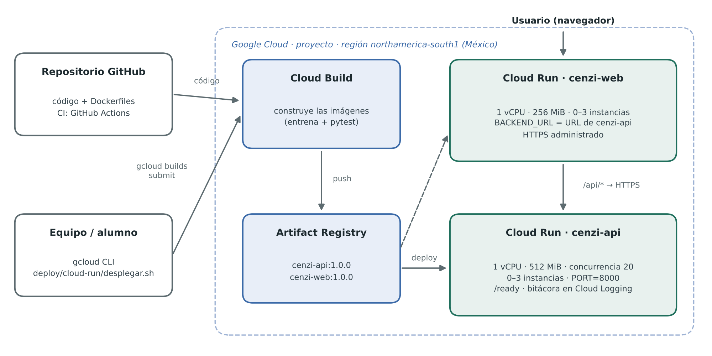

# Manual de despliegue en la nube · Cenzi

Versión en Markdown del manual. La versión completa, con justificación de la estrategia y figuras, está en `Manual_Despliegue_Nube_Cenzi.docx`.



## 1. Proceso paso a paso

| Paso | Qué se hace | Herramienta |
|---|---|---|
| 1 | Obtener el código | git |
| 2 | Construir y validar en local | Docker Compose |
| 3 | Preparar el proyecto de Google Cloud | Consola · gcloud |
| 4 | Crear el repositorio de imágenes | Artifact Registry |
| 5 | Construir y publicar las imágenes | Cloud Build |
| 6 | Desplegar la API | Cloud Run |
| 7 | Desplegar la interfaz conectada a la API | Cloud Run |
| 8 | Verificar | curl · prueba de humo |
| 9–11 | Nueva versión · revertir · apagar | Cloud Run · gcloud |

Los pasos 3 a 8 están automatizados: `PROYECTO=<id> bash deploy/cloud-run/desplegar.sh`.

### Paso 1. Obtener el código
```bash
git clone https://github.com/<usuario>/<repositorio>.git && cd <repositorio>
cp .env.example .env
```

### Paso 2. Construir y validar en local
```bash
docker compose up --build -d
docker compose ps                 # ambos (healthy)
sh pruebas/smoke_test.sh          # "Prueba de humo correcta."
docker compose down
```

### Paso 3. Preparar Google Cloud
Proyecto con facturación activa; Google Cloud CLI o Cloud Shell.
```bash
gcloud auth login
export PROYECTO=<id-del-proyecto> REGION=northamerica-south1
gcloud config set project $PROYECTO
gcloud services enable run.googleapis.com artifactregistry.googleapis.com cloudbuild.googleapis.com
```

### Paso 4. Repositorio de imágenes
```bash
gcloud artifacts repositories create cenzi --repository-format=docker --location=$REGION
export REGISTRO=$REGION-docker.pkg.dev/$PROYECTO/cenzi
```

### Paso 5. Construir y publicar (el build del backend entrena y ejecuta las 68 pruebas)
```bash
gcloud builds submit backend  --tag $REGISTRO/cenzi-api:1.0.0
gcloud builds submit frontend --tag $REGISTRO/cenzi-web:1.0.0
```

### Paso 6. Desplegar la API
```bash
gcloud run deploy cenzi-api --image $REGISTRO/cenzi-api:1.0.0 --region $REGION --port 8000 \
  --cpu 1 --memory 512Mi --concurrency 20 --min-instances 0 --max-instances 3 --timeout 30 \
  --set-env-vars CENZI_ENV=cloudrun,CENZI_LOG_LEVEL=INFO,WEB_CONCURRENCY=2 --allow-unauthenticated
export API_URL=$(gcloud run services describe cenzi-api --region $REGION --format 'value(status.url)')
```

### Paso 7. Desplegar la interfaz
```bash
gcloud run deploy cenzi-web --image $REGISTRO/cenzi-web:1.0.0 --region $REGION --port 8080 \
  --cpu 1 --memory 256Mi --concurrency 80 --min-instances 0 --max-instances 3 --timeout 30 \
  --set-env-vars BACKEND_URL=$API_URL --allow-unauthenticated
export WEB_URL=$(gcloud run services describe cenzi-web --region $REGION --format 'value(status.url)')
```

### Paso 8. Verificar
```bash
sh pruebas/smoke_test.sh $WEB_URL $API_URL
gcloud run services logs read cenzi-api --region $REGION --limit 20
```

### Pasos 9–11. Operación
```bash
# Nueva versión
gcloud builds submit backend --tag $REGISTRO/cenzi-api:1.1.0
gcloud run deploy cenzi-api --image $REGISTRO/cenzi-api:1.1.0 --region $REGION
# Revertir
gcloud run revisions list --service cenzi-api --region $REGION
gcloud run services update-traffic cenzi-api --region $REGION --to-revisions <revision-anterior>=100
# Apagar
gcloud run services delete cenzi-web --region $REGION --quiet
gcloud run services delete cenzi-api --region $REGION --quiet
gcloud artifacts repositories delete cenzi --location $REGION --quiet
```

## 2. Requerimientos técnicos

- **Local:** Docker 24+ con Compose v2, 2 núcleos, 2 GB de RAM libres, 3 GB de disco, puertos 8000 y 8080, acceso a Docker Hub y PyPI.
- **Nube:** proyecto de Google Cloud con facturación; APIs de Cloud Run, Artifact Registry y Cloud Build; roles Cloud Run Admin, Artifact Registry Writer, Cloud Build Editor y Service Account User.
- **Recursos por servicio:** API 1 vCPU / 512 MiB / concurrencia 20; web 1 vCPU / 256 MiB / concurrencia 80; 0–3 instancias. Basado en las pruebas de carga: ≈ 215 solicitudes/s por instancia, p95 de 75 ms con 10 clientes simultáneos.
- **Variables de entorno:** ver la tabla del [README](../README.md#configuración-variables-de-entorno).

## 3. Estrategia de despliegue

Contenedores sin servidor en **Google Cloud Run**, dos servicios independientes, región `northamerica-south1` (México):

- La misma imagen probada en local corre en la nube; ambas respetan la variable `PORT`.
- Escala de 0 a N instancias; sin costo de CPU en reposo.
- Capa gratuita mensual: 180 000 vCPU-segundos, 360 000 GiB-segundos y 2 millones de solicitudes.
- HTTPS administrado, revisiones inmutables y reversión moviendo el tráfico.

Alternativas portables: **Azure Container Apps** (`az containerapp up --source ./backend ...`) y **Render** (Web Service con entorno Docker, directorio raíz `backend` o `frontend`).

Integración continua: `.github/workflows/ci.yml` construye, levanta y prueba el sistema en cada push.

## 4. Herramientas de documentación

- **FastAPI / OpenAPI:** documentación de la API generada desde el código (`/docs`, `/openapi.json`).
- **Markdown versionado:** este manual y el README.
- **Asistente de IA generativa y GitHub Copilot:** borradores de documentación y docstrings; todo comando y cifra se verificó ejecutándolo (salidas en `resultados/`).
- **GitHub Actions:** comprueba en cada cambio que el inicio rápido sigue funcionando.

## Solución de problemas

| Síntoma | Solución |
|---|---|
| El build falla en `pytest` | `cd backend && python -m pytest -q`, corregir la prueba que falla |
| «failed to start and listen on the port» | `--port` debe ser 8000 (API) u 8080 (web) |
| La interfaz dice «Backend no disponible» | Revisar `BACKEND_URL` del servicio `cenzi-web` |
| Primera consulta lenta (2–4 s) | Arranque en frío; usar `--min-instances 1` si se requiere |
| `/ready` responde 503 | Ver bitácora `error_carga_modelo`; revisar `CENZI_MODEL_PATH` |
| `/docs` en blanco | La red bloquea el CDN de Swagger UI; usar `/openapi.json` |
